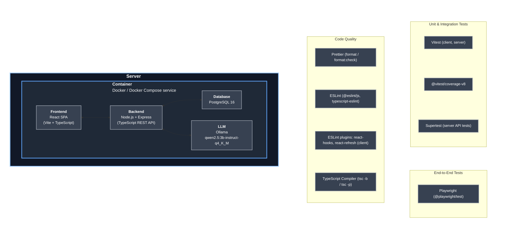

# Darkness Caress II

*"The long-awaited sequel to the legendary game."*

A fully deployed website with a **1-vs-1 turn-based strategy game** in the spirit of Fire Emblem (but simpler).
The battlefield/board layout can be generated from AI calls (via a local LLM, Ollama) and is validated by a deterministic rules engine that guarantees legality, while enemy move turns are decided by server-side deterministic policies.
The game is asynchronous by design — the player takes a turn, the AI thinks in the background, the player keeps up to 5 concurrent games.

- **Architecture:** React SPA (Vite) + Express API + PostgreSQL, one VM via docker-compose, AI in Docker via Ollama.
- **Docs-first architecture:** the `docs/` folder — a complete agent-briefing spec set for implementation and maintenance.

| Doc | What it is |
|---|---|
| `docs/00-project-overview.md` | Constitution: product decisions, rules, deferrals |
| `docs/01-architecture.md` | Stack, repo layout, schema, deployment |
| `docs/02-game-rules.md` | Combat, movement, turn engine (pure module spec) |
| `docs/03-board-generation.md` | AI-designed boards, materialized + validated |
| `docs/04-ai-integration.md` | LLM client, personas, prompts, validation loop |
| `docs/05-frontend.md` | Every screen and interaction |
| `docs/06-api-contract.md` | The full HTTP API |
| `docs/07-assets.md` | Art pipeline contract (placeholder → owner art) |
| `docs/08-agent-rules.md` | What agents may and may not decide |
| `docs/09-build-order.md` | Phases with acceptance checklists |
| `docs/11-phase-8-code-refactor.md` | Phase 8 code refactor plan |
| `docs/12-phase-9-ui-refactor.md` | Phase 9 UI refactor plan |

## Project structure



## Player quickstart (requires Docker Desktop installed)
On Windows 11: run `play.cmd` to install and start the game.

## Dev quickstart

```bash
cp .env.example .env        # set JWT_SECRET etc.
npm install -ws             # workspaces
docker compose up -d db     # Postgres
npm -w server run dev       # API on :3000
npm -w client run dev       # Vite on :5173 (proxies /api)
```

Tests: `npm -w server test`, `npm -w client test`, `npm run e2e` (Playwright). Production: `docker compose up -d` (serves the SPA + API from one container; Ollama runs beside it).

## Test players

To test the game, use the already set up player:

- **test_player**
  - **Email:** test_player@bigschool.com
  - **Password:** test_player123
